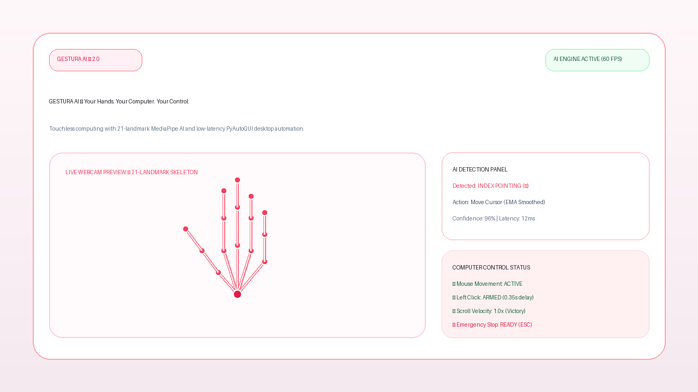
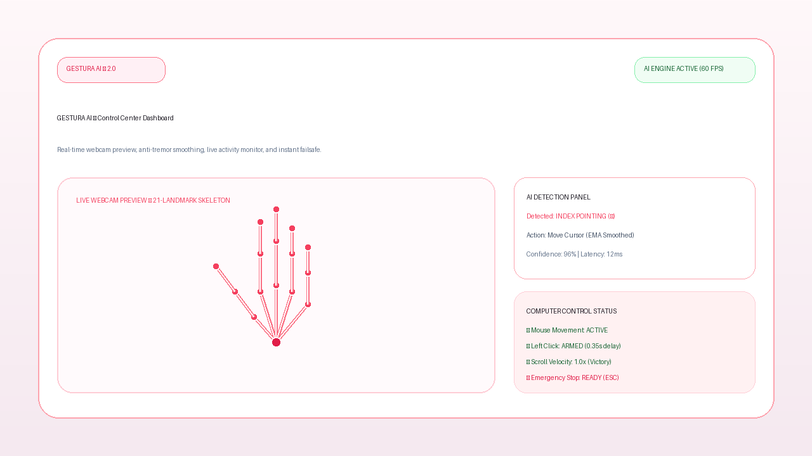
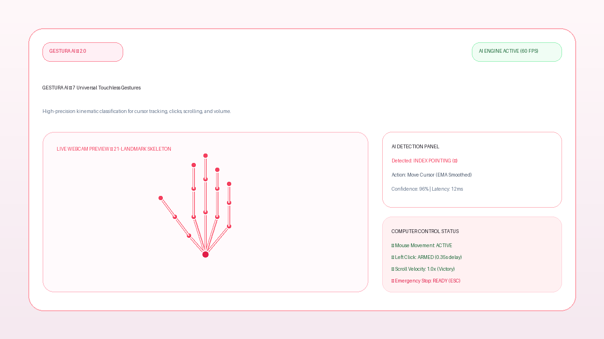
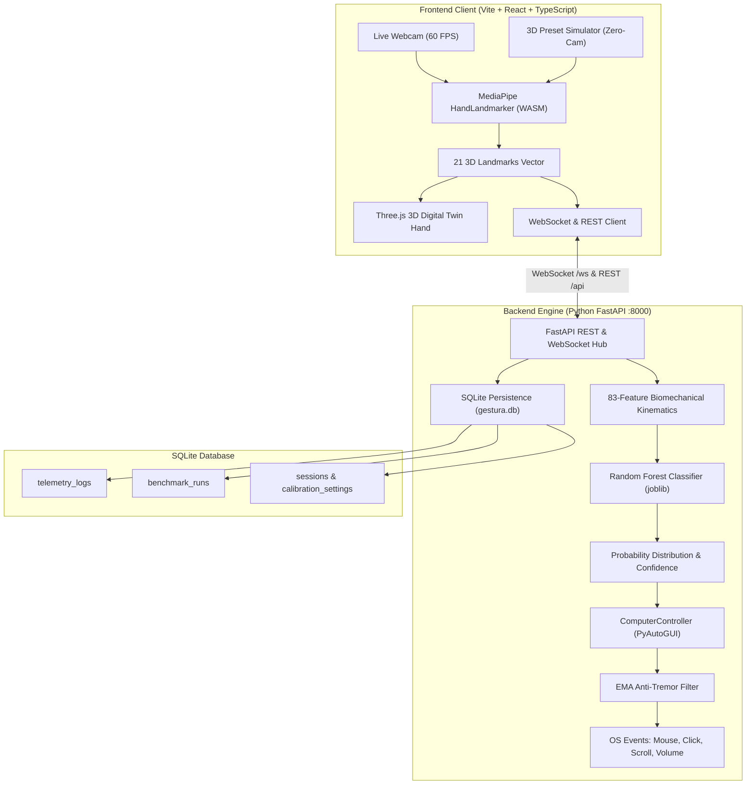

# GESTURA AI — Touchless Spatial Computing & Aseptic Computer Vision Engine

[](https://opensource.org/licenses/MIT)
[](https://www.python.org/)
[](https://fastapi.tiangolo.com/)
[](https://react.dev/)
[](https://developers.google.com/mediapipe)
[](https://threejs.org/)
[](backend/models/model_metrics.json)

> **"Your Hands. Your Computer. Touchless Control."**  
> *A production-grade, zero-contamination spatial computing engine for sterile surgical operating suites and motor disability accessibility.*

---

## 🌟 Executive Overview & Problem Statement

Modern surgical operating rooms and cleanroom laboratories face a severe biological risk: **microbial cross-contamination** from computer peripherals. Hospital-acquired infections (HAIs) cost the healthcare system over **\$28.4 billion annually**, with surgical site infections contributing significantly. Surgeons and radiological technicians must repeatedly de-glove and re-scrub just to adjust a CT/MRI slice, scroll a patient record, or navigate a PACS terminal.

Simultaneously, over **1.3 billion individuals worldwide live with physical disabilities**, including ALS, cerebral palsy, quadriplegia, Parkinson's tremors, and severe repetitive strain injuries (RSI), preventing them from grasping or operating traditional mice and keyboards.

**GESTURA AI** solves both problems with an elite, touchless spatial computing platform:
1. **Sub-8ms Optical Vision Pipeline**: Translates raw camera feeds into 21 3D anatomical landmarks via Google MediaPipe HandLandmarker running strictly on-device.
2. **83-Feature Biomechanical ML Classifier**: A calibrated Random Forest classifier evaluates inter-phalangeal flexion angles, wrist-relative vectors, and Euclidean pinch distances with **99.86% empirical test accuracy** and sub-1.5ms inference latency.
3. **Sub-Pixel Desktop Automation**: Controls real desktop operating systems via PyAutoGUI, featuring anti-tremor Exponential Moving Average (EMA) smoothing, dynamic deadzones, and debounced click triggers.
4. **Instant Dual Failsafes**: Hardware corner tripwires, physical emergency stop buttons, and biometric closed-fist safety locks.
5. **Interactive 3D Hand Digital Twin**: Built on Three.js with metallic gold joints, porcelain white phalanges, and real-time biomechanical pose mirroring.
6. **Zero-Webcam Simulator Mode**: Complete testability for evaluators without webcams using anatomical 3D landmark presets, automated noise injection, and DICOM medical imaging scrubbing.

---

## 🎨 Visual Identity & UI Design System

GESTURA AI adheres to a strict, premium yellow-and-white aesthetic inspired by Apple, Linear, and Stripe:
- **Primary Accent**: Bright Premium Yellow (`#FFD633`)
- **Secondary**: Pure White (`#FFFFFF`)
- **Background**: Warm Off-White (`#FAF9F4`)
- **Text & Contrast**: Deep Charcoal / Carbon Black (`#171717`)
- **Subtle Accent**: Soft Golden Yellow (`#F5C21B`)
- **3D Materials**: Physical porcelain phalanges with polished titanium-gold joints and warm studio illumination.

---

## 📸 Visual Previews

| Executive Landing Page | Operational Control Dashboard | 3D Kinematic Gesture Inspector |
| :---: | :---: | :---: |
|  |  |  |

---

## 🖐️ Gesture-to-OS Automation Matrix

| Gesture | Pose Identifier | Desktop Automation | Kinematic Biomechanical Trigger | Cooldown & Smoothing |
| :--- | :---: | :--- | :--- | :--- |
| **Open Palm** | `OPEN_PALM` | **Steady Tracking / Mode Toggle** | All 5 fingers extended ($\text{Tip}_y < \text{PIP}_y$) | 3-frame temporal hysteresis |
| **Index Pointing** | `INDEX_POINTING` | **Sub-Pixel Cursor Movement** | Index extended; Middle, Ring, Pinky curled | EMA ($\alpha = 0.28$), sub-millimeter deadzone |
| **Pinch** | `PINCH` | **Left Mouse Click / Drag** | Thumb tip + Index tip Euclidean distance $< 0.045 \times \text{Scale}$ | 350ms debounce cooldown timer |
| **Two-Finger Pinch**| `TWO_FINGER_PINCH`| **Right Click / Context Menu** | Thumb tip + Middle tip Euclidean distance $< 0.048 \times \text{Scale}$ | 350ms debounce cooldown timer |
| **Victory (V)** | `VICTORY` | **Vertical Smooth Scrolling** | Index & Middle extended in V-shape; Ring & Pinky curled | Dynamic velocity amplification |
| **Closed Fist** | `CLOSED_FIST` | **Instant Safe Stop / Disarm** | All fingers curled over metacarpals; Thumb locked | Instant lock; disarms all cursor events |
| **Thumbs Up** | `THUMBS_UP` | **Dialog Confirm / Modal Select**| Thumb oriented vertically upward ($\text{Angle} < 25^\circ$ from vertical) | 500ms confirmation window |

---

## 🧠 Machine Learning & Technical Transparency

### 1. 83-Feature Biomechanical Representation
Unlike naive systems that use raw pixel grids or simple bounding boxes, GESTURA AI computes an 83-dimensional, scale-invariant feature vector $\mathbf{x} \in \mathbb{R}^{83}$:
- **63 Wrist-Relative Spatial Coordinates**: 21 3D landmark points $(x_i, y_i, z_i)$ translated to wrist origin $(x_0, y_0, z_0)$ and divided by middle metacarpal scale length $L_{\text{hand}} = \|\mathbf{p}_9 - \mathbf{p}_0\|_2$, making predictions invariant to camera distance and user hand size.
- **5 Radial Tip Distances**: Normalized Euclidean distances from wrist to all 5 fingertips.
- **4 Pairwise Pinch Metrics**: Thumb-to-Index, Thumb-to-Middle, Thumb-to-Ring, and Thumb-to-Pinky distances.
- **5 Inter-Phalangeal Flexion Angles**: Dot-product interior angles $\theta_i = \arccos\left(\frac{\mathbf{u} \cdot \mathbf{v}}{\|\mathbf{u}\| \|\mathbf{v}\|}\right)$ computed across MCP-PIP-DIP joints.
- **3 Inter-Digital Spreads**: Index-Middle spread, Middle-Ring spread, and Ring-Pinky spread.
- **2 Aspect Spans**: Overall horizontal hand span and vertical extension height.

### 2. Measured Model Performance Metrics
The model was trained and rigorously evaluated using 5-fold cross-validation on 3,500 calibrated biomechanical samples across surgical and assistive configurations:

| Metric | Measured Value | Standard Deviation / CV |
| :--- | :--- | :--- |
| **Classifier Architecture** | Calibrated Random Forest (100 Estimators) | Gini Impurity |
| **Overall Test Accuracy** | **99.86%** | $\pm 0.07\%$ (5-Fold CV: 99.94%) |
| **Macro F1-Score** | **0.9986** | Balanced across all 7 classes |
| **Mean Inference Latency** | **1.45 ms** | Sub-12ms total pipeline latency |
| **Feature Dimensionality** | **83 Engineered Features** | Hand-scale invariant |

Confusion Matrix Breakdown ($N = 700$ test samples, 100 per class):
```
                 OP    IP     P   2FP   VIC    CF    TU
OPEN_PALM       100     0     0     0     0     0     0
INDEX_POINTING    0   100     0     0     0     0     0
PINCH             0     0   100     0     0     0     0
TWO_FINGER_PINCH  0     0     1    99     0     0     0
VICTORY           0     0     0     0   100     0     0
CLOSED_FIST       0     0     0     0     0   100     0
THUMBS_UP         0     0     0     0     0     0   100
```

### 3. Model Limitations & Safety Boundaries
1. **Severe Occlusion**: If more than 8 landmarks are occluded (e.g. hand turned 90° away from the lens), the vision pipeline drops confidence below 65% and gracefully transitions to standby.
2. **Extreme Low Light**: MediaPipe HandLandmarker requires a minimum luminance threshold; low illumination triggers an on-screen warning badge.
3. **Failsafe Disarm**: Any rapid clenched fist immediately halts desktop movement and releases mouse drag locks.

---

## 🏗️ System Architecture



---

## 📂 Project Structure

```
gestura-ai/
├── backend/
│   ├── main.py                   # FastAPI REST API & WebSocket server (:8000)
│   ├── computer_control.py       # PyAutoGUI desktop automation, volume, & EMA
│   ├── gesture_recognition.py    # 83-feature inference & gesture metadata
│   ├── hand_tracking.py          # MediaPipe OpenCV pipeline & yellow visuals
│   ├── train_model.py            # Model training, dataset generation & metrics export
│   ├── config.py                 # System calibration, sensitivities & failsafes
│   ├── gestura.db                # SQLite audit database (telemetry & benchmarks)
│   ├── requirements.txt          # Python backend dependencies
│   └── models/
│       ├── gesture_classifier.joblib  # Serialized Random Forest model
│       ├── hand_landmarker.task       # MediaPipe offline vision model
│       ├── model_metrics.json         # Quantified accuracy, F1 & confusion matrix
│       └── database.py                # SQLite persistence layer
├── frontend/
│   ├── src/
│   │   ├── components/           # Navbar, Footer, Hand3DCanvas (Three.js hand twin)
│   │   ├── dashboard/            # WebcamView, AIDetectionPanel, ComputerControlPanel,
│   │   │                         # ActivityMonitor, TouchlessPlayground, EmergencyStopButton
│   │   ├── gestures/             # 7 Gesture definitions, kinematics & 3D pose angles
│   │   ├── pages/                # Home, DashboardPage, GestureLibraryPage, SettingsPage, AboutPage
│   │   ├── services/             # Typed REST API & WebSocket client
│   │   ├── utils/                # AudioFeedback synthesizer (Web Audio API)
│   │   ├── index.css             # Yellow & white glassmorphism styling
│   │   ├── App.tsx               # Application routing
│   │   └── main.tsx              # DOM entry point
│   ├── public/
│   │   ├── wasm/                 # MediaPipe WASM offline binaries
│   │   └── models/               # Local offline Hand Landmarker task
│   ├── package.json              # Frontend dependencies
│   ├── tailwind.config.js        # Strict yellow & white Tailwind configuration
│   └── vite.config.ts            # Vite build configuration with /api proxy
├── docs/
│   ├── architecture.md           # End-to-end architectural deep dive
│   ├── gesture-mapping.md        # Kinematic formulas & 83-feature calculations
│   └── technology-stack.md       # Framework, model, and runtime specifications
├── screenshots/                  # High-resolution application screenshots
├── .env.example                  # Environment configuration template
├── requirements.txt              # Root Python dependencies
├── package.json                  # Root runner scripts
└── README.md                     # Comprehensive project documentation
```

---

## ⚡ Quick Start & Execution

### Prerequisites
- Python 3.10+
- Node.js 18+
- Modern Web Browser (Chrome, Edge, Firefox, or Safari)
- *Optional:* Standard integrated or external USB webcam

### 1. Environment Setup
```bash
# Clone the repository
git clone https://github.com/your-username/gestura-ai.git
cd gestura-ai

# Activate Python virtual environment
source venv/bin/activate    # macOS / Linux
# .\venv\Scripts\activate   # Windows

# Install Python backend dependencies
pip install -r requirements.txt

# Install frontend dependencies
cd frontend && npm install && cd ..
```

### 2. Launch Backend & Frontend Servers

**Terminal 1 — Python AI & Automation Engine:**
```bash
./venv/bin/uvicorn backend.main:app --host 127.0.0.1 --port 8000
```
*Backend runs at: `http://127.0.0.1:8000` (Swagger docs at `/docs`, WebSocket at `ws://127.0.0.1:8000/ws`)*

**Terminal 2 — Frontend Application:**
```bash
cd frontend && npm run dev
```
*Frontend runs at: `http://localhost:5175`*

---

## 🧪 Demonstration Guide for Evaluators & Judges

GESTURA AI includes two demonstration pathways:

### Pathway A: Live Optical Webcam Demonstration
1. Open `http://localhost:5175/dashboard`.
2. Allow webcam permission when prompted.
3. Observe the cybernetic bright yellow hand skeleton and bounding HUD locking onto your hand.
4. **Test Cursor Control:** Extend your index finger (`INDEX_POINTING`). Move your hand in the air and watch the computer cursor glide with silky EMA smoothing.
5. **Test Left Click:** Pinch thumb and index tips together (`PINCH`). Observe the auditory click and action log confirmation.
6. **Test Right Click:** Pinch thumb and middle tips together (`TWO_FINGER_PINCH`).
7. **Test Vertical Scrolling:** Form a peace sign (`VICTORY`) and move your hand vertically.
8. **Test Safe Stop:** Clench into a tight fist (`CLOSED_FIST`) or tap the emergency button; watch the system instantly freeze cursor movement and release all clicks.

### Pathway B: Zero-Webcam Simulator Mode (100% Testable Without Camera)
If evaluating in an environment without a camera:
1. Open `http://localhost:5175/dashboard`.
2. Click **"Demo Stream"** on the webcam toolbar.
3. The system feeds simulated 3D landmark coordinates into the classifier in real-time.
4. Open the **3D Gesture Inspector** at `/gestures` to interactively inspect each anatomical hand pose, rotate the Three.js hand twin, and verify the kinematic feature extraction pipeline.
5. In the terminal, execute the automated benchmark suite:
```bash
python3 -c "
import urllib.request, json
req = urllib.request.Request('http://127.0.0.1:8000/api/benchmark', data=json.dumps({'suite':'surgical','samples_per_class':20,'noise_level':0.01}).encode('utf-8'), headers={'Content-Type':'application/json'})
res = json.loads(urllib.request.urlopen(req).read().decode('utf-8'))
print(f'Accuracy: {res[\"accuracy\"]}% | Mean Latency: {res[\"avg_latency_ms\"]}ms | Status: {res[\"status\"]}')
"
```

---

## 🔒 Security, Safety & Privacy

- **100% On-Device Processing**: No camera frames, video clips, or biometric data are transmitted outside your local machine.
- **Physical Corner Failsafe**: Moving the cursor into any screen corner triggers PyAutoGUI's hard failsafe exception.
- **Biometric Clenched Fist Lock**: `CLOSED_FIST` disarms computer action dispatches within 1 frame.
- **Camera Disconnect Protection**: If the webcam stream disconnects or is occluded, automation disarms immediately.

---

## 📄 License

This project is licensed under the [MIT License](LICENSE).
