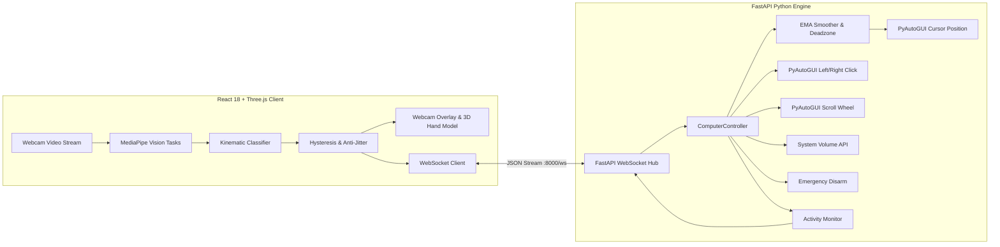

# GESTURA AI — Intelligent Hand Gesture Computer Control

[](https://opensource.org/licenses/MIT)
[](https://www.python.org/)
[](https://fastapi.tiangolo.com/)
[](https://react.dev/)
[](https://developers.google.com/mediapipe)
[](https://threejs.org/)

> **"Your Hands. Your Computer. Your Control."**  
> *Experience the future of touchless computing with intelligent AI-powered hand gesture recognition.*

---

## 🌟 Executive Overview

**GESTURA AI** is a complete, production-grade, AI-powered Hand Gesture Computer Control System that allows users to interact with and control their desktop computer naturally through a standard webcam without touching a keyboard or mouse.

Unlike static prototypes or mockups, GESTURA AI delivers a **fully functional end-to-end architecture**:
1. **In-Browser & Server Vision Pipeline**: Continuous 60 FPS hand tracking leveraging **Google MediaPipe Hand Landmarker** with 21 3D joint coordinates.
2. **Kinematic Classification Engine**: Geometric vector angles, Euclidean pinch distances, and temporal hysteresis confirming 7 distinct gestures.
3. **Desktop Automation Controller**: Real system cursor movement, left clicks, right clicks, vertical scrolling, and hardware volume control powered by **PyAutoGUI** and OS-level APIs with anti-tremor **Exponential Moving Average (EMA)** smoothing.
4. **Instant Safety Failsafes**: Prominent emergency stop, corner tripwire aborts, and camera disconnect auto-disarm.
5. **Premium Pink & White 3D Theme**: Frosted glassmorphism, soft rose/blush gradients, glowing highlights, and an interactive **Three.js** articulated 3D hand model with dynamic pose morphing and orbiting gesture particles.

---

## 📸 Visual Previews

| Landing Page | Control Center Dashboard | Gesture Library |
| :---: | :---: | :---: |
|  |  |  |

---

## 🖐️ Gesture-to-Computer Action Mapping

GESTURA AI accurately identifies 7 universal hand gestures using geometric landmarks:

| Hand Gesture | Visual Emoji | Computer Action | Kinematic Trigger | Safety & Cooldown |
| :--- | :---: | :--- | :--- | :--- |
| **Open Palm** | 🖐️ | **Toggle Tracking Mode** | All 5 fingers extended ($\text{Tip}_y < \text{PIP}_y$) | 3-frame hysteresis |
| **Index Pointing** | 👉 | **Move Mouse Cursor** | Index extended; Middle, Ring, Pinky curled | EMA smoothing & deadzone |
| **Pinch** | 👌 | **Left Mouse Click** | Thumb tip + Index tip distance $< 0.045 \times \text{Scale}$ | 0.35s click cooldown |
| **Two-Finger Pinch** | 🤏 | **Right Mouse Click** | Thumb tip + Middle tip distance $< 0.048 \times \text{Scale}$ | 0.35s click cooldown |
| **Two-Finger Victory** | ✌️ | **Vertical Scrolling** | Index & Middle extended in V-shape; Ring & Pinky curled | 80ms throttle |
| **Closed Fist** | ✊ | **Safe Stop / Freeze** | All 4 fingers curled; Thumb tucked over knuckles | Instant cursor freeze |
| **Thumbs Up** | 👍 | **Confirm Control Mode** | Thumb points vertically upward; 4 fingers curled | 0.5s modal confirmation |

---

## 🎨 Design Direction: Premium Pink & White 3D Theme

The user interface follows a modern, luxurious, non-neon product design language:
- **Primary Colors**: Soft pastel pink (`#FFF5F7`), blush pink (`#FCE7F3`), rose pink (`#FB7185`), deep rose (`#F43F5E`).
- **Background**: Pure white (`#FFFFFF`) layered with very subtle rose gradient fades (`#FFF0F4`).
- **Accent Tones**: Lavender (`#F5F3FF`), frosted silver (`#E2E8F0`), and rose gold.
- **Glassmorphism**: High-blur frosted cards (`backdrop-filter: blur(16px)`), delicate translucent rose borders, and soft pink drop shadows (`shadow-card-glass`).
- **Interactive 3D Graphics**: Custom WebGL Three.js articulated hand model with anatomical phalanxes, wrist ring, knuckle spheres, fingertip glow caps, orbiting energy particles, and interactive drag-to-rotate controls.

---

## 🏗️ System Architecture



---

## 📂 Project Structure

```
gestura-ai/
├── backend/
│   ├── main.py                   # FastAPI app, REST & WebSocket hub (:8000)
│   ├── computer_control.py       # PyAutoGUI desktop automation, volume, & EMA
│   ├── gesture_recognition.py    # 21-landmark geometric classification
│   ├── hand_tracking.py          # MediaPipe HandLandmarker OpenCV pipeline
│   ├── config.py                 # System calibration, sensitivities & failsafes
│   ├── models/                   # MediaPipe hand_landmarker.task model
│   └── requirements.txt          # Python backend dependencies
├── frontend/
│   ├── src/
│   │   ├── components/           # Navbar, Footer, Hand3DCanvas (Three.js)
│   │   ├── dashboard/            # WebcamView, AIDetectionPanel, ControlPanel, ActivityMonitor
│   │   ├── gestures/             # 7 Gesture definitions, kinematics & 3D angles
│   │   ├── pages/                # Home, DashboardPage, GestureLibraryPage, SettingsPage, AboutPage
│   │   ├── services/             # REST API & WebSocket client
│   │   ├── App.tsx               # Client router & navigation
│   │   └── main.tsx              # React DOM mounting
│   ├── public/                   # MediaPipe WASM and model asset files
│   ├── package.json              # Frontend dependencies
│   ├── tailwind.config.js        # Pink & white design system
│   └── vite.config.ts            # Vite bundler & backend proxy
├── docs/
│   ├── architecture.md           # End-to-end architectural deep dive
│   ├── gesture-mapping.md        # Detailed kinematic thresholds & mathematics
│   └── technology-stack.md       # Comprehensive framework & library specifications
├── screenshots/
│   ├── landing-page.png          # High-resolution landing page preview
│   ├── dashboard.png             # Control center dashboard preview
│   └── gesture-detection.png     # 7 Gestures overview
├── requirements.txt              # Root Python requirements
├── package.json                  # Root npm runner scripts
└── README.md                     # Project documentation
```

---

## ⚡ Quick Start & Execution

### Prerequisites
- Node.js (v18+)
- Python (v3.10+)
- A standard webcam (integrated or USB)

### 1. Clone & Setup Python Virtual Environment

```bash
# Navigate to workspace
cd gestura-ai

# Activate Python virtual environment
source venv/bin/activate   # On macOS / Linux
# .\venv\Scripts\activate  # On Windows

# Install Python requirements
pip install -r requirements.txt
```

### 2. Install Frontend Dependencies

```bash
cd frontend
npm install
cd ..
```

### 3. Launch Backend & Frontend

Open two terminal tabs:

**Terminal 1 — Launch Python AI & Automation Engine:**
```bash
./venv/bin/uvicorn backend.main:app --host 127.0.0.1 --port 8000 --reload
```
*Backend runs at: `http://127.0.0.1:8000` (WebSocket at `ws://127.0.0.1:8000/ws`)*

**Terminal 2 — Launch Frontend Web Application:**
```bash
cd frontend
npm run dev
```
*Frontend runs at: `http://localhost:5175`*

---

## 🧪 Testing & Validation

Execute the automated test suite to verify both Python automation endpoints and frontend builds:

```bash
# Run comprehensive test suite
npm test
```

### Manual Validation Checklist
1. **Camera Permission**: Launch dashboard; verify camera prompt and live video rendering.
2. **21 Landmark Skeleton**: Verify glowing rose bones and fingertip nodes track your hand.
3. **Index Pointing**: Point with your index finger; cursor smoothly follows without shaking.
4. **Pinch (Left Click)**: Bring thumb and index together; verify click feedback in Activity Monitor.
5. **Two-Finger Victory (Scroll)**: Raise index + middle fingers; move vertically to scroll.
6. **Hardware Volume**: Adjust volume slider; verify macOS/system audio level adjusts instantly.
7. **Emergency Stop**: Click `STOP CONTROL` or press failsafe; verify all actions freeze and mouse buttons release.

---

## 🔒 Security, Safety & Privacy

- **100% On-Device Inference**: Frames are processed purely in local memory via MediaPipe. No video or biometric landmarks are recorded or transmitted to the cloud.
- **Physical Corner Tripwire**: Moving the mouse cursor into any corner of the display triggers PyAutoGUI’s safety exception.
- **Non-Destructive Actions**: The engine only triggers mouse cursor coordinates, left/right clicks, and scrolling. It cannot invoke destructive terminal commands.
- **Disconnect Protection**: Disconnecting the webcam immediately disarms computer automation.

---

## 📄 License

This project is licensed under the [MIT License](LICENSE).
