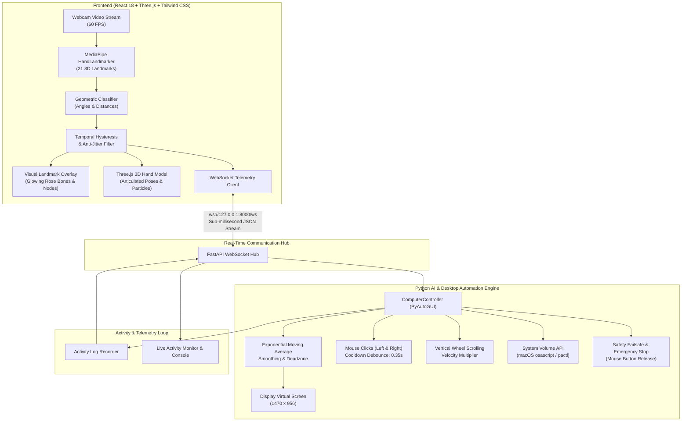

# GESTURA AI — System Architecture

GESTURA AI is a dual-tier touchless human-computer interface that combines computer vision, real-time kinematics, and operating-system-level desktop automation.



---

## 1. Vision Layer: Hand Landmark Extraction

The optical tracking engine leverages Google MediaPipe Hand Landmarker Vision Tasks running on WebAssembly with WebGL GPU acceleration.

### 21 Landmark Topology
Each detected hand contains 21 distinct 3D landmarks ($x, y, z \in [0.0, 1.0]$):
- `0`: Wrist Base
- `1-4`: Thumb (CMC, MCP, IP, TIP)
- `5-8`: Index Finger (MCP, PIP, DIP, TIP)
- `9-12`: Middle Finger (MCP, PIP, DIP, TIP)
- `13-16`: Ring Finger (MCP, PIP, DIP, TIP)
- `17-20`: Pinky Finger (MCP, PIP, DIP, TIP)

### Normalization & Scale Invariance
To eliminate variations caused by hand distance from the webcam lens, landmark coordinates are dynamically scaled by the hand scale metric:

$$\text{Scale} = \sqrt{(x_{\text{MCP middle}} - x_{\text{wrist}})^2 + (y_{\text{MCP middle}} - y_{\text{wrist}})^2}$$

All subsequent pinch and proximity calculations divide euclidean distances by $\text{Scale}$.

---

## 2. Desktop Automation & Smoothing Filter

Raw hand landmarks exhibit micro-tremors caused by natural human muscle twitching and optical sensor noise. Direct coordinate mapping would cause annoying cursor jitter.

GESTURA AI applies a dual-stage anti-tremor pipeline:

### A. Deadzone Filter
If displacement between consecutive frames is below $\epsilon_{\text{deadzone}} = 0.003$, cursor position is held constant:

$$\Delta d = \sqrt{\left(\frac{x_{\text{target}} - x_{\text{prev}}}{W}\right)^2 + \left(\frac{y_{\text{target}} - y_{\text{prev}}}{H}\right)^2}$$

$$\text{If } \Delta d < \epsilon_{\text{deadzone}} \implies \text{No mouse movement}$$

### B. Exponential Moving Average (EMA)
When displacement exceeds the deadzone, coordinates are interpolated smoothly:

$$x_{\text{smoothed}}^{(t)} = \alpha \cdot x_{\text{target}} + (1 - \alpha) \cdot x_{\text{smoothed}}^{(t-1)}$$
$$y_{\text{smoothed}}^{(t)} = \alpha \cdot y_{\text{target}} + (1 - \alpha) \cdot y_{\text{smoothed}}^{(t-1)}$$

Where $\alpha \in [0.05, 0.45]$ is dynamically adjusted based on the operator's **Cursor Speed** and **Sensitivity** settings.

---

## 3. Communication Protocol (WebSocket JSON)

The client and server exchange real-time JSON packets at up to 60 Hz over `ws://127.0.0.1:8000/ws`:

### Client Telemetry Packet
```json
{
  "type": "telemetry",
  "gesture": "INDEX_POINTING",
  "confidence": 95,
  "fingertip": { "x": 0.542, "y": 0.381 },
  "metrics": {
    "pinch_distance": 0.42,
    "two_finger_pinch_distance": 0.38,
    "scroll_delta_y": -0.012
  }
}
```

### Server Execution Receipt
```json
{
  "type": "telemetry_ack",
  "gesture": "INDEX_POINTING",
  "action_executed": "MOUSE_MOVE",
  "action_success": true,
  "recent_log": [
    {
      "id": "17101000_1",
      "timestamp": "22:45:10",
      "action": "MOUSE_MOVE",
      "details": "Pos: (796, 364)",
      "success": true
    }
  ],
  "emergency_stopped": false
}
```

---

## 4. Emergency Stop & Safety Tripwire

1. **Physical Failsafe**: PyAutoGUI `FAILSAFE = True` is permanently active. Moving the cursor to any screen corner immediately raises a failsafe exception.
2. **One-Click Software Stop**: Pressing the prominent red/rose `STOP CONTROL` button sends `{"type": "emergency_stop"}`:
   - Sets `config.emergency_stopped = True`.
   - Releases any mouse button held down (`mouseUp('left')`, `mouseUp('right')`).
   - Locks mouse movement until explicitly resumed.
3. **Camera Loss Protection**: If video frames cease or camera is disconnected, all controls auto-disarm.
